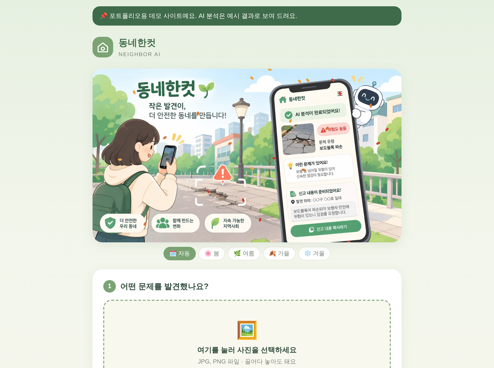
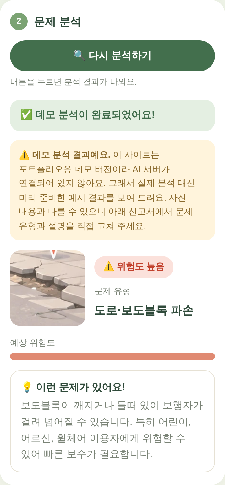
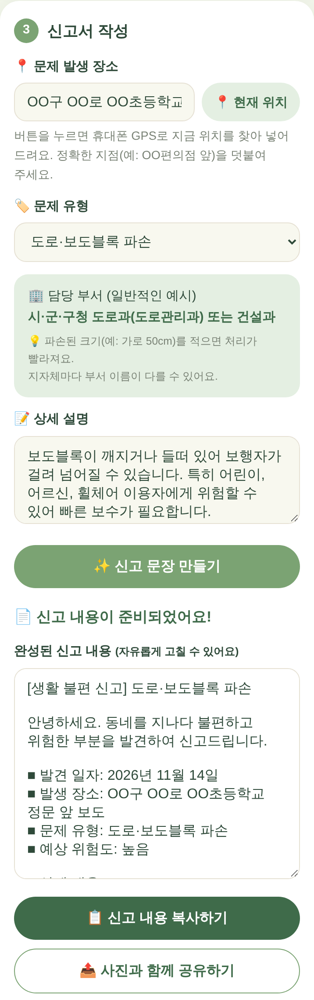
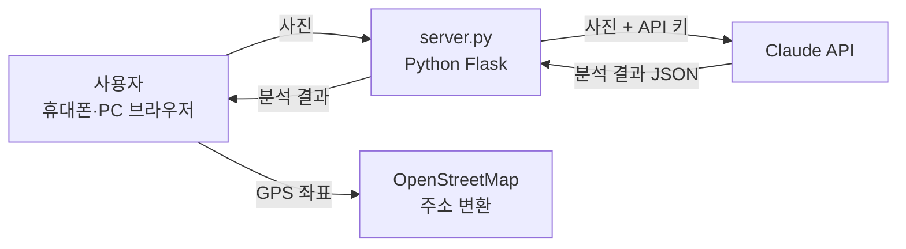

# 🌱 동네한컷 (NEIGHBOR AI)

> **사진 한 장으로 동네의 위험 요소를 분석하고, 신고서까지 만들어 주는 웹 서비스**

| 🔗 바로가기 | |
|---|---|
| 데모 사이트 | https://yoonsieun0159.github.io/dongne-hancut/ |
| 실제 AI 분석 시연 영상 | 준비 중 |



---

## 1. 만든 이유

동네를 걷다 보면 깨진 보도블록, 꺼진 가로등, 방치된 쓰레기처럼 불편하거나 위험한 곳을 자주 보게 됩니다.
하지만 신고하려고 하면 **어떤 문제인지, 어느 부서에, 어떤 문장으로** 적어야 할지 몰라서 그냥 지나치기 쉽습니다.

**동네한컷**은 이 과정을 줄이기 위해 만들었습니다.
사진을 찍으면 AI가 문제의 종류와 위험도를 정리하고, 바로 붙여 넣을 수 있는 신고 문장을 만들어 줍니다.

## 2. 주요 기능

| 분석 결과 | 신고서 작성 |
|---|---|
|  |  |

- **📷 사진 업로드:** JPG·PNG 업로드, 미리보기, 교체·삭제, 끌어다 놓기
- **🤖 AI 문제 분석 (Claude API):** 문제 유형 6가지 분류, 위험도(낮음/보통/높음), 확신도, 설명, 판단 이유
- **🔒 개인정보 안내:** 사진에 얼굴이나 차량 번호판이 보이면 가리라고 알려 줌
- **📍 현재 위치 입력:** 휴대폰 GPS로 위치를 찾아 주소로 변환하고, 지도 링크를 신고서에 첨부
- **🏢 담당 부서 안내:** 문제 유형별 일반적인 담당 부서와 신고 팁
- **📝 신고서 자동 작성:** 장소, 유형, 설명을 모아 신고 문장 생성 (직접 수정 가능)
- **📋 복사·공유:** 클립보드 복사, 휴대폰 공유 창으로 사진과 함께 보내기
- **🔗 신고 바로가기:** 안전신문고, 국민신문고, 120 민원 상담
- **🍂 계절 효과:** 날짜에 따라 꽃잎, 나뭇잎, 낙엽, 눈이 내리는 효과가 자동으로 바뀜
- **📱 반응형 디자인:** 휴대폰과 PC 모두 지원

## 3. 동작 구조



- **화면(`index.html`):** HTML, CSS, JavaScript 파일 하나로 만들었습니다. 사진은 보내기 전에 브라우저에서 크기를 줄입니다.
- **서버(`server.py`):** 사진을 검사한 뒤 Claude API로 보내고, 정해진 JSON 형식으로 결과를 받아 화면에 돌려줍니다.
- **데모 모드:** 서버에 연결할 수 없으면(예: GitHub Pages) **"데모 분석 결과"라고 분명히 표시한 뒤** 예시 결과를 보여 줍니다.

## 4. 사용 기술

| 구분 | 기술 |
|---|---|
| 화면 | HTML, CSS, JavaScript (프레임워크 없이) |
| 서버 | Python, Flask |
| AI | Claude API (`claude-opus-5-5`), 이미지 입력, 구조화된 출력(JSON Schema) |
| 브라우저 기능 | Geolocation API, Clipboard API, Web Share API, Canvas(사진 축소) |
| 지도·주소 | OpenStreetMap Nominatim (주소 변환), 카카오맵 링크 |
| 배포 | GitHub Pages (데모 사이트) |

## 5. 고민한 점

**1) API 키를 어디에 둘 것인가**
API 키를 화면 코드에 넣으면 사이트를 보는 누구나 키를 볼 수 있습니다.
그래서 키는 Python 서버의 `.env` 파일에만 두고, 화면은 서버에 사진만 보내도록 나눴습니다. `.env`는 `.gitignore`로 GitHub에 올라가지 않게 막았습니다.

**2) AI가 아닌 결과를 AI 결과처럼 보이지 않게**
서버가 없을 때도 화면을 체험할 수 있도록 예시 결과를 준비했습니다.
다만 이때는 항상 **"데모 분석 결과"라는 안내와 그 이유**를 함께 보여 주도록 했습니다.

**3) AI 답을 화면에서 안전하게 쓰기**
AI 답을 자유로운 글이 아닌 **정해진 JSON 형식**(유형, 위험도, 설명 등)으로 받도록 설정했습니다.
그래서 화면이 항상 같은 방식으로 결과를 표시할 수 있습니다. 문제 유형도 정해진 6가지 중에서만 고르게 했습니다.

**4) 사용자가 최종 확인하도록**
AI도 틀릴 수 있기 때문에 신고를 자동으로 제출하지 않습니다.
문제 유형, 설명, 신고 문장을 사용자가 직접 고칠 수 있게 했고, 제출은 공식 신고 창구에서 직접 하도록 안내합니다.

## 6. 실행 방법

### 데모 사이트
위의 **데모 사이트** 링크를 열면 됩니다. 설치할 것은 없습니다. AI 분석은 예시 결과로 나옵니다.

### AI 분석까지 실행하기 (내 컴퓨터)
1. [Anthropic Console](https://console.anthropic.com)에서 API 키를 만듭니다.
2. `.env.example` 파일을 복사해서 이름을 `.env`로 바꾸고, 키를 적습니다.
   ```
   ANTHROPIC_API_KEY=sk-ant-...
   ```
3. 패키지를 설치하고 서버를 실행합니다.
   ```bash
   pip install -r requirements.txt
   python server.py
   ```
4. 브라우저에서 http://localhost:5000 을 엽니다.

> 사진 1장을 분석할 때마다 Claude API 요금이 나옵니다. 콘솔에서 월 사용 한도를 정해 두는 것을 권장합니다.

## 7. 파일 구성

```
├─ index.html        화면 (HTML·CSS·JavaScript, 대표 이미지 포함)
├─ server.py         AI 분석 서버 (Python Flask + Claude API)
├─ requirements.txt  파이썬 패키지 목록
├─ .env.example      API 키 설정 예시
├─ .gitignore        GitHub에 올리지 않을 파일 (.env)
├─ images/hero.webp  대표 이미지 원본
└─ docs/             README 화면 캡처
```

## 8. AI 도구 활용

- 코드 작성과 구조 설계에 AI 코딩 도구(Claude)의 도움을 받았습니다.
- 대표 이미지는 생성형 AI(ChatGPT)로 만들었습니다.
- 기능 기획, 디자인 방향, 테스트와 수정 요청은 직접 진행했습니다.

## 9. 한계와 개선 계획

- [ ] AI 서버를 인터넷에 배포하고, 남용을 막는 이용 횟수 제한 추가
- [ ] 같은 장소의 신고 기록을 모아 보는 지도 기능
- [ ] 신고 처리 결과를 기록하는 기능
- [ ] 담당 부서 안내를 지자체별로 더 정확하게
