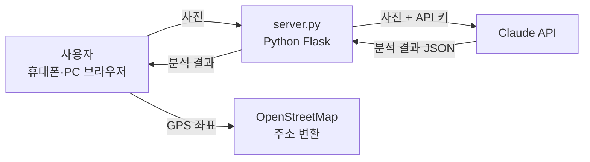

# 🌱 동네한컷 (NEIGHBOR AI)

> **사진 한 장으로 동네의 위험 요소를 분석하고, 신고서까지 만들어 주는 웹 서비스**

### 🔗 바로가기
- **🌐 데모 사이트:** [yoonsieun0159.github.io/dongne-hancut](https://yoonsieun0159.github.io/dongne-hancut/)
- **🎬 실제 AI 분석 시연 영상:** 준비 중


---

## 1. 만든 이유

우리는 길에 깨진 보도블록, 고장난 가로등, 방치된 쓰레기처럼 불편하거나 위험한 곳을 보게 됩니다.
하지만 신고하려고 하면 **어떤 문제인지, 어느 부서에, 어떤 문장으로** 적어야 할지 몰라서 그냥 지나치기 쉬웠습니다.
또한 어르신들은 복잡한 과정에 더욱 불편함을 느끼고 신고에 어려움을 겪을 것입니다.

**동네한컷**은 이 과정을 줄이기 위해 만들었습니다.
사진을 찍으면 AI가 문제의 종류와 위험도를 정리하고, 빠르게 신고 할 수 있는 문장과 부서를 바로 이동할 수 있게 만들어 줍니다.
직접 한다면 신고까지 복잡한 과정들을 최소화 하여 바쁜 생활 속 1-2분 이면 가능하게 하고 싶었습니다. 
사소해 보이는 불편함 하나를 해결하는 작은 변화가 모여, 더 나은 사회를 만들어 간다고 믿습니다.


## 2. 주요 기능

| 분석 결과 | 신고서 작성 |
|---|---|
|  |  |

- **사진 업로드:** JPG·PNG 업로드, 미리보기, 교체·삭제, 끌어다 놓기
- **AI 문제 분석 (Claude API):** 문제 유형 6가지 분류, 위험도(낮음/보통/높음), 확신도, 설명, 판단 이유
- **개인정보 안내:** 사진에 얼굴이나 차량 번호판이 보이면 가리라고 알려 줌
- **현재 위치 입력:** 휴대폰 GPS로 위치를 찾아 주소로 변환하고, 지도 링크를 신고서에 첨부
- **담당 부서 안내:** 문제 유형별 일반적인 담당 부서와 신고 팁
- **신고서 자동 작성:** 장소, 유형, 설명을 모아 신고 문장 생성 (직접 수정 가능)
- **복사·공유:** 클립보드 복사, 휴대폰 공유 창으로 사진과 함께 보내기
- **신고 바로가기:** 안전신문고, 국민신문고, 120 민원 상담


## 3. 동작 구조



- **화면(`index.html`):** HTML, CSS, JavaScript 파일 하나로 만들었습니다. 사진은 보내기 전에 브라우저에서 크기를 줄입니다.
- **서버(`server.py`):** 사진을 검사한 뒤 Claude API로 보내고, 정해진 JSON 형식으로 결과를 받아 화면에 돌려줍니다.
- **데모 모드:** 서버에 연결할 수 없으면(예: GitHub Pages) **"데모 분석 결과"라고 분명히 표시한 뒤** 예시 결과를 보여 줍니다.


## 4. 사용 기술

| 구분 | 기술 |
|---|---|
| 화면 | HTML, CSS, JavaScript (프레임워크 없이) |
| 서버 | Python, Flask |
| AI | Claude API (`claude-opus-5-5`), 이미지 입력, 구조화된 출력(JSON Schema) |
| 브라우저 기능 | Geolocation API, Clipboard API, Web Share API, Canvas(사진 축소) |
| 지도·주소 | OpenStreetMap Nominatim (주소 변환), 카카오맵 링크 |
| 배포 | GitHub Pages (데모 사이트) |


## 5. 개발 과정에서 고민한 점

**1) API 키를 어떻게 안전하게 관리할 것인가**

AI API 키를 프런트엔드 코드에 직접 작성하면 웹사이트에 접근하는 누구나 키를 확인할 수 있다는 보안 문제가 있습니다.

이를 방지하기 위해 프런트엔드와 백엔드의 역할을 분리했습니다. API 키는 Python 서버의 `.env` 파일에서 관리하고, 프런트엔드는 서버에 사진과 요청 정보만 전달하도록 설계했습니다. 또한 `.gitignore`를 활용해 민감한 정보가 GitHub에 공개되지 않도록 했습니다.

**2) 실제 AI 분석과 데모 결과를 어떻게 구분할 것인가**

실제 AI 서버가 연결되지 않은 상황에서도 사용자가 서비스의 주요 기능을 체험할 수 있도록 데모 분석 결과를 마련했습니다.

다만 데모 결과가 실제 AI의 판단으로 오해되지 않도록 결과 화면에 '데모 분석 결과'라는 안내와 함께 실제 AI 분석이 아닌 이유를 명확하게 표시하도록 했습니다.

**3) AI의 응답을 어떻게 일관되고 안정적으로 처리할 것인가**

AI는 같은 질문에도 다양한 형태로 답변할 수 있기 때문에, 결과를 화면에 안정적으로 표시하는 방법을 고민했습니다.

이를 위해 AI 응답을 자유로운 문장이 아닌 정해진 JSON 형식으로 받도록 설계했습니다. 문제 유형, 위험도, 설명 등의 항목을 구조화하고, 문제 유형 역시 사전에 정의한 6가지 범위 안에서 선택하도록 제한했습니다.

**4) AI의 판단을 어디까지 신뢰하고 활용할 것인가**

AI의 분석 결과가 항상 정확한 것은 아니므로, AI가 판단한 내용을 그대로 신고에 반영하는 방식은 적절하지 않다고 생각했습니다.

따라서 문제 유형과 위험도, 설명 및 신고 문장을 사용자가 직접 확인하고 수정할 수 있도록 했습니다. 또한 신고를 자동으로 제출하는 대신 사용자가 최종적으로 검토한 후 공식 신고 창구를 통해 직접 제출하도록 설계했습니다.

이 과정을 통해 AI의 편리함뿐 아니라 정확성, 보안, 사용자 통제의 중요성도 함께 고려했습니다.


## 6. 실행 방법

### 데모 사이트
위의 **데모 사이트** 링크를 열면 됩니다. 설치할 것은 없습니다. AI 분석은 예시 결과로 나옵니다.

### AI 분석까지 실행하기 (내 컴퓨터)
1. [Anthropic Console](https://console.anthropic.com)에서 API 키를 만듭니다.
2. `.env.example` 파일을 복사해서 이름을 `.env`로 바꾸고, 키를 적습니다.
   ```
   ANTHROPIC_API_KEY=sk-ant-...
   ```
3. 패키지를 설치하고 서버를 실행합니다.
   ```bash
   pip install -r requirements.txt
   python server.py
   ```
4. 브라우저에서 http://localhost:5000 을 엽니다.

> 사진 1장을 분석할 때마다 Claude API 요금이 나옵니다. 콘솔에서 월 사용 한도를 정해 두는 것을 권장합니다.


## 7. 파일 구성

```
├─ index.html        화면 (HTML·CSS·JavaScript, 대표 이미지 포함)
├─ server.py         AI 분석 서버 (Python Flask + Claude API)
├─ requirements.txt  파이썬 패키지 목록
├─ .env.example      API 키 설정 예시
├─ .gitignore        GitHub에 올리지 않을 파일 (.env)
├─ images/hero.webp  대표 이미지 원본
└─ docs/             README 화면 캡처
```


## 8. AI 도구 활용

- 코드 작성과 구조 설계에 AI 코딩 도구(Claude)의 도움을 받았습니다.
- 대표 이미지는 생성형 AI(ChatGPT)로 만들었습니다.
- 기능 기획, 디자인 방향, 테스트와 수정 요청은 직접 진행했습니다.


## 9. 한계와 개선 계획

- [ ] AI 서버를 인터넷에 배포하고, 남용을 막는 이용 횟수 제한 추가
- [ ] 같은 장소의 신고 기록을 모아 보는 지도 기능
- [ ] 신고 처리 결과를 기록하는 기능
- [ ] 담당 부서 안내를 지자체별로 더 정확하게


## 10. 관심 분야와 앞으로의 발전 방향

저는 AI가 단순히 정보를 제공하는 것을 넘어, 실제 물리적 환경을 이해하고 사람들의 생활에 직접적인 도움을 주는 기술로 발전하는 과정에 관심이 많습니다.

특히 카메라와 센서를 통해 주변 환경을 인식하고, 상황을 판단해 적절한 행동으로 연결하는 로봇 및 Physical AI 분야에 큰 흥미를 가지고 있습니다.

이번 프로젝트인 '동네한컷' 역시 이러한 관심에서 출발했습니다. 카메라로 주변 환경을 인식하고, AI가 문제 상황을 분석한 뒤 사용자가 적절하게 대응할 수 있도록 돕는 서비스를 만들고자 했습니다.

현재는 웹 기반의 작은 프로토타입이지만, 환경을 인식하고 상황을 판단한다는 기본적인 접근 방식은 향후 자율주행 로봇이나 생활 지원 로봇에도 확장될 수 있다고 생각합니다.

앞으로도 AI가 실제 세계와 상호작용하며 사람들의 일상에 실질적인 가치를 만들어 내는 기술을 공부하고 개발하고 싶습니다.
